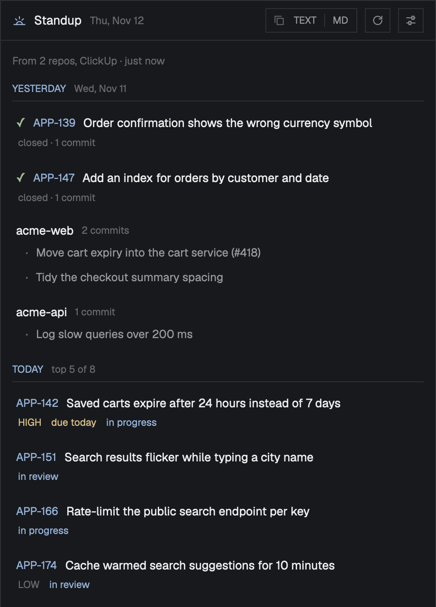

# Standup for Herdr

A [Herdr](https://herdr.dev) side panel that writes your daily standup from where your work already is:

- **Yesterday:** the tickets you closed, the pull requests you merged, opened or reviewed, and your commits that reached each repo's main branch. On a Monday that's Friday.
- **Today:** your open tickets, most pressing first (overdue or due today, then in progress, then by priority, then the soonest due), then the reviews waiting on you.
- **Blockers:** tickets whose status or labels say they're blocked, plus anything you type.

**TEXT** and **MD** copy it to the clipboard as plain text or as Markdown, ready for Slack, a GitHub comment or your notes. Click any ticket, pull request or commit to open it.

It works in any layout: it takes the colors of your theme and the font of your layout.

## Install

The simplest way is to ask the agent in your Herdr window:

> Add the Herdr mod from https://github.com/BenGlasser/herdr-standup

Or do it by hand:

1. Copy `mods/standup/` to `~/.config/herdr-app/mods/standup/`.
2. Run `herdr-app check ~/.config/herdr-app/mods/standup`.

Herdr docks it on the right of the layout you're in, the first time it sees it. Herdr's shipped layouts are read-only, so it waits for one of your own; make one with `herdr-app do layout.clone '{"name":"main","as":"my-layout"}'`. Or open it as a window from anywhere with `herdr-app do mod.open --name standup`.

## Setup

The first time it opens, it shows its settings (⚙ later):

- **Repositories:** folders of your git repos (a folder of repos counts each one in it). Your commits that reached each repo's main branch count: origin's default branch, or the branches you name ("development, main"). Your commit email is git's `user.email` in each repo, plus any you add. It can fetch origin first, and can also count commits not merged yet.
- **Trackers,** each one off until you turn it on:

| Tracker | What it reads | How it signs in |
|---|---|---|
| ClickUp | Your open tasks, and the ones you finished | A personal API token (`pk_…`) |
| GitHub | Issues assigned to you; pull requests you merged, opened or reviewed; reviews waiting on you | The `gh` CLI's sign-in |
| GitLab | The same, for issues and merge requests | A personal access token with `read_api` (gitlab.com or your own server) |
| Linear | Your open issues, and the ones you completed | A personal API key |
| Jira | Your open issues, and the ones that reached Done | Cloud: your email and an API token. Data Center: a personal access token |

Tokens are checked with their service, then kept in your system keychain: the macOS Keychain, or the Secret Service on Linux (service `herdr-standup`, one account per tracker).

- **The report:** whether yesterday is the previous workday or the previous day, and how many items Today lists.

## What it accesses

- **Git:** reads your repos (`git log`, `rev-parse`, `config user.email`); with "Fetch from origin first" on, it fetches each repo's main branch. It never changes a repo otherwise.
- **Network:** only the trackers you turn on: ClickUp's, GitLab's, Linear's and Jira's APIs, and GitHub through `gh api graphql`. It only reads.
- **Programs:** `git`, `find`, `gh` (GitHub), `security` or `secret-tool` (the keychain), `pbcopy`, `wl-copy` or `xclip` (the clipboard), `open` or `xdg-open` (links).
- **Files:** the folders you add, read-only; nothing else outside its own folder.

It works on macOS and Linux.

## More

[`RECIPE.md`](RECIPE.md) is the full brief: the exact look, behavior, sources, limits, and checks that prove a build works. An agent can rebuild the mod from it in an empty folder.

## License

[MIT](LICENSE).
