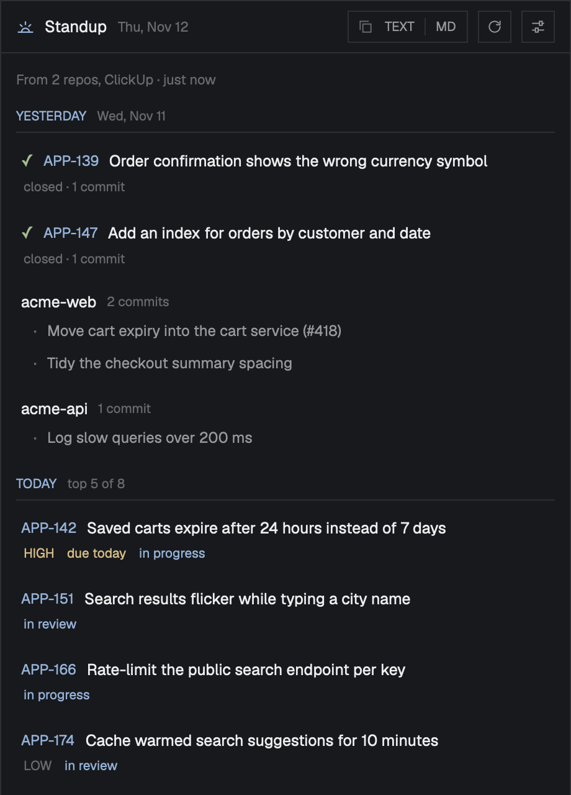

# Standup

A side panel that writes your daily standup from your git repos and the trackers you turn on: what you did on the last workday (tickets closed, pull requests merged, opened or reviewed, commits that reached each repo's main branch), what's next today (your open tickets, most pressing first, then reviews waiting on you), and what's in your way (blocked tickets, plus anything you type). TEXT and MD copy it as plain text or Markdown. It works in any layout, taking the theme's colors and the layout's font.

## What you see

The panel fills its block. Colors are theme names; the preview shows Herdr's default `graphite` theme. Text is the layout's UI font at 13px in `foreground` unless said otherwise.

- **Frame:** `background`, a 1px `border` all round.
- **Header, 42px**, 12px side padding, 8px gaps, a `border` line under it: a 15px sunrise icon in `accent`; **Standup** at 13px bold; today's date at 11px in `dim` ("Thu, Nov 12"); a spacer; the copy pair; refresh (⟳); settings (⚙). Buttons are 26px with a 1px `border`, 10.5px bold `muted` text, turning `accent` on hover. The copy pair is one bordered box: a copy icon in `dim`, then **TEXT**, a 1px divider, **MD**; the one just copied reads **COPIED** in `ansi2` for 2 seconds.
- **Status line,** 11px `dim`: "Reading git, ClickUp…" while it reads (the sources still being read), then "From 2 repos, ClickUp · just now". Each source's problem goes under it, one line each, in `blocked` ("GitHub: gh isn't signed in (run gh auth login)").
- **Sections:** a label at 10.5px bold in `accent` with a `border` line under it, and 10.5px `dim` text beside it.
  - **YESTERDAY** (or the weekday's name when it's further back, like FRIDAY), with its date ("Wed, Nov 11"):
    - a closed ticket: ✓ in `ansi2`, its id at 11.5px bold in `accent`, its title truncated, and under it in `dim` "closed · 2 commits · merged web#418"
    - a pull request: a PR icon colored by what happened (merged `ansi5`, opened or approved `ansi2`, changes requested `ansi3`, reviewed `ansi4`), its id (`web#418`, `api!12`), its title, and under it "merged", "approved · sam's", "reviewed · 1 commit"
    - the rest by repo: the repo's name in bold and "3 commits" (`ansi3` "· not merged yet" for unmerged work), then up to 4 subjects in `muted` with a `dim` dot, and "2 more" / "Show fewer" in `accent`
    - nothing: "Nothing closed, reviewed or committed."
  - **TODAY**, with "top 5 of 14" when there are more: open tickets, each with a line of bold 10.5px details: the priority in capitals unless normal (`URGENT` in `blocked`, `HIGH` in `ansi3`, `LOW` in `dim`), the due date ("overdue 2d" in `blocked`, "due today"/"due tomorrow" in `ansi3`, "due Fri, Nov 14" in `muted`), and the status when in progress (`ansi4`) or blocked (`blocked`). Then reviews waiting on you: a PR icon in `ansi3`, the id and title, and "review requested · from kim · opened 2d ago" in bold `ansi3`; "and 3 more reviews waiting" past the limit.
  - **BLOCKERS:** blocked tickets as in Today, or "No blocked tickets.", then a text box ("Anything in your way? Each line goes in the copy.") with a 1px `input` border.
- **Settings view** (⚙; also the first view until something is set up): a header with a gear, "Standup settings" and **DONE** (filled `solid`, or `raised` and dim until a repo or tracker is set). Groups, each with an 11px bold `accent` title and an 11.5px `dim` note:
  - **REPOSITORIES:** one row per folder (its path with `~`, a 150px branches field placeholder "auto", × to remove), and **+ Add folder** (the system folder picker).
  - **YOUR COMMIT EMAILS:** the emails found, a field for more, and two checkboxes: "Fetch from origin first, so merged work is up to date" (on) and "Also count commits not merged yet, on any branch" (off). A checkbox is a 14px square, filled `accent` when on; its label wraps.
  - **THE REPORT:** "Yesterday means" (The previous workday (Monday: Friday) / The previous day) and "Today lists up to" (3 / 5 / 8 / 12), as 26px choice chips, `accent` with `selected` behind when chosen.
  - **CLICKUP, GITHUB, GITLAB, LINEAR, JIRA:** a note on what it reads and how it signs in, "Use <name>", and once on: its fields. A token row is "Token kept in the macOS Keychain" in `ansi2` with **Replace**, or a masked field with **Save** ("Checking…" while it's tried) and any problem in `blocked`. GitHub: "Issues assigned to you", "Pull requests: yours, ones you reviewed, and reviews waiting on you", "Only (a search filter)". GitLab: server, token, issues, merge requests. Jira: site, email, token, "Only (a JQL condition)".

## How it behaves

- **Agent status:** the panel shows none.
- **When it reads:** when it first shows with something set up, on ⟳, and once a day while it shows. With a `block` prop it reads only while that block is on screen. Sources are read side by side; each that finishes redraws.
- **Yesterday's span:** local time, from the start of the previous workday (Friday on a Monday, with the weekend in it) or the previous day, to the start of today.
- **Git:** each folder that is a repo, else the repos one level inside it; worktrees of one repo count once (by their shared `.git`). The main branch: the named branches as `origin/<b>` when there is one, else `<b>`; or origin's default (`origin/HEAD`), else `origin/main`, `origin/master`, `main`, `master`. On their first-parent line in the span, it counts commits by your emails and merges that brought in a commit of yours. A merge reads as its pull request: GitHub's "Merge pull request #12 …" becomes the body's first line with "(#12)"; GitLab's "Merge branch … into …" with "See merge request g/api!12" becomes its title with "(!12)".
- **Tickets:** open ones assigned to you, and ones finished in the span. Progress: a status or label like progress, doing, review, active, started. Blocked: like block, waiting, on hold (Linear also: an unfinished issue that blocks it). Priority: the tracker's, or labels like P1, `priority::high`, `urgent`.
- **Pull requests:** yours merged or opened in the span, others' you approved, requested changes on or reviewed in the span (one line each, keeping what counts most: merged, opened, approved, changes, reviewed), and open ones waiting on your review, oldest first. A pull request whose title or branch names a closed ticket goes on that ticket's line; a commit goes on a pull request's line when it's in the same repo and its subject has "(#12)" or "(!12)", or it's on the request's branch.
- **Today's order:** overdue or due today, then in progress, then priority, then the soonest due, then the most recently updated. Blocked tickets go to Blockers instead.
- **Copy:** TEXT: no markup, "Yesterday (Wed, Nov 11)", "• Closed APP-139: … — 1 commit (https://…)". MD: "**Yesterday** (Wed, Nov 11)", "- Closed [APP-139](https://…): … — 1 commit". Blockers you typed go last, one per line. It goes to the clipboard (pbcopy; wl-copy or xclip on Linux; PowerShell on Windows).
- **Notes:** the blockers box is kept for the day (shared `standup.notes`), saved when you leave it.
- **Settings:** shared `standup.settings`; tokens in the keychain, checked first (who they belong to).
- **Clicks:** a ticket, pull request or commit opens its page in the browser.
- **Motion:** none.

## Built from

- **Files:** `mods/standup/`
  - `main.js`: the panel (report and settings views)
  - `report.js`: pure: the span, ranking, matching commits and pull requests to tickets, the report and its text (`lookback`, `rankToday`, `names`, `mentions`, `inPr`, `build`, `text`)
  - `sources.js`: git (`findRepos`, `emails`, `mainRefs`, `commits`), the keychain (`readToken`, `saveToken`), `copy`, `browse`
  - `trackers.js`: ClickUp, GitHub, GitLab, Linear, Jira (`clickup`, `github`, `gitlab`, `linear`, `jira`), `checkToken`, `base64`
  - `mod.json`: `{ "place": "right", "size": 440, "title": "Standup", "overlay": { "kind": "window", "width": 460, "height": 640 } }`
  - icons: `standup.svg`, `refresh.svg`, `settings.svg`, `copy.svg`, `pr.svg`
- **Props:** `block` (its id in the layout, so it reads only while shown); `dock: true` in Nightdrive's panel dock.
- **Herdr APIs:** `props()`, `theme()`, `layout()`, `home()`, `window()` (`platform`), `pickFolder`, `shared()` / `setShared()`, `exec`, `fetch`, `cx.spawn`, `cx.timer.after`; from `gpui-base`: `InputState` + `Input`, `TextareaState` + `Textarea`, `Scrollbar`.
- **Sources:**
  - git: `rev-parse --show-toplevel --git-common-dir`, `config user.email`, `symbolic-ref refs/remotes/origin/HEAD`, `fetch --quiet origin <b>`, `log <ref> --first-parent --since --until`, `log <parent>..<merge>`, and for unmerged work `log --branches --remotes --no-merges --author … --source --not <refs>`
  - ClickUp: `GET /user`, `/team`, `/team/<id>/task` (open: `include_closed=false`; finished: `include_closed=true&date_done_gt&date_done_lt`)
  - GitHub: one `gh api graphql` search query with `viewer { login }` and searches for open and closed issues, merged and opened pull requests, ones you reviewed (with their reviews), and `review-requested:@me`
  - GitLab: `/user`, `/issues?scope=assigned_to_me`, `/merge_requests?scope=created_by_me` (merged; created in the span), `/events?action=approved|commented`, `/projects/<id>/merge_requests/<iid>`, `/merge_requests?reviewer_username=<you>`
  - Linear: one GraphQL query: `viewer.assignedIssues` open (state type not completed or canceled) and completed in the span, with labels and `inverseRelations` (blocks)
  - Jira: Cloud `GET /rest/api/3/search/jql` (with `nextPageToken`), Data Center `GET /rest/api/2/search`; JQL `assignee = currentUser()` with `statusCategory != Done`, and `statusCategory = Done AND updated >= -Nd` filtered by when it was done
- **Keychain:** service `herdr-standup`, accounts `clickup`, `gitlab`, `linear`, `jira`.

## Watch out

- **Rendering:** `cx.notify()` isn't allowed during `render`. The daily read starts from render, so it must only note its progress there and redraw when a source finishes.
- **Jira dates:** `2026-11-11T14:00:00.000-0500` isn't ISO (no colon in the offset): fix the offset before `Date.parse`.
- **Jira sign-in:** Cloud takes Basic auth (`email:token`, base64; the runtime may have no `btoa`); Data Center takes `Bearer <token>`.
- **Linear:** personal keys go in `Authorization` as they are, without "Bearer". Keep each connection's `first` small: Linear limits a query's complexity.
- **GitHub search:** dates in qualifiers are whole days; search a day wider and filter by the exact times.
- **GitLab events:** `after`/`before` are whole days too; the same.
- **Commit email:** without git's `user.email` and with none added, no commit counts; say so.
- **Inputs:** stop the mouse-down on every text box (`cx.stop_propagation()`), or a press drags the panel in a window.
- **Limits:** 5 pages of ClickUp tasks, 50 GitHub results per search, 100 GitLab items per call, 50 Linear issues each way, 300 Jira issues; 4 commits shown per repo until expanded.

## Done when

- `herdr-app check mods/standup` passes.
- With nothing set up it opens on its settings, and DONE is dim until a repo or tracker is.
- With a folder of repos: it finds each repo once, your commits from the last workday that reached main show under their repo, and a merge reads as its pull request's title.
- On a Monday, Yesterday is labeled FRIDAY and covers Friday to Sunday.
- With ClickUp on: tickets finished in the span show as closed, with the commits that name them; open ones fill Today in the order above; a blocked one shows under Blockers.
- With GitHub on: a pull request you merged yesterday shows, and goes on its ticket's line when its title or branch names it.
- TEXT puts plain text with no markup on the clipboard; MD puts Markdown with linked ids; the button reads COPIED.
- A blocker typed in the box is in the copy, and is still there after the panel restarts the same day.
- A wrong token shows "<Tracker> turned that token down (…)" and isn't kept.
